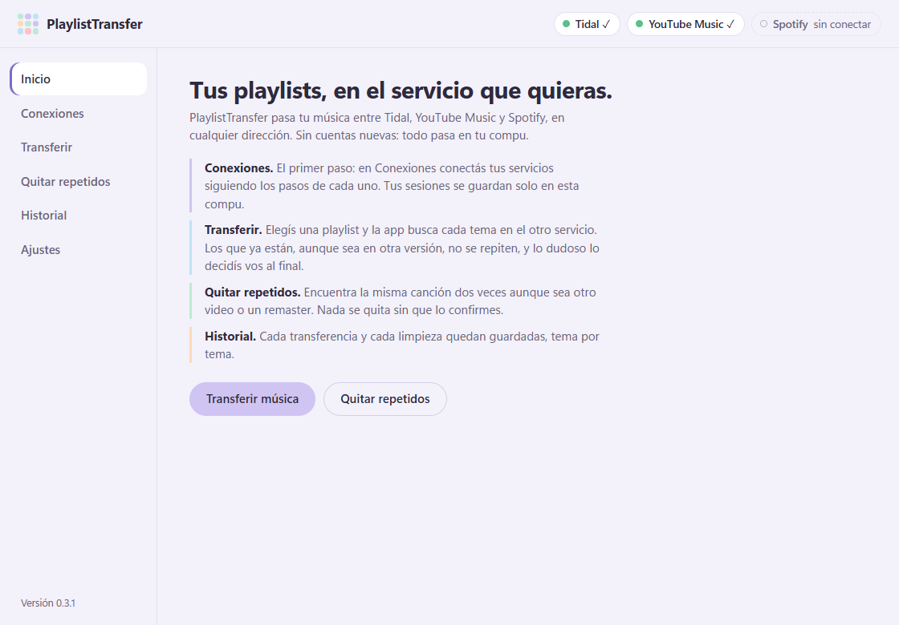
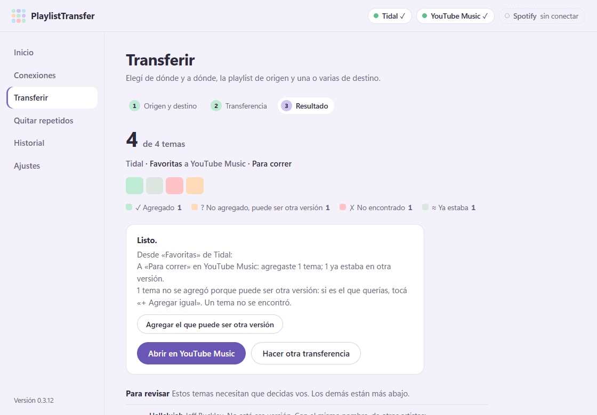
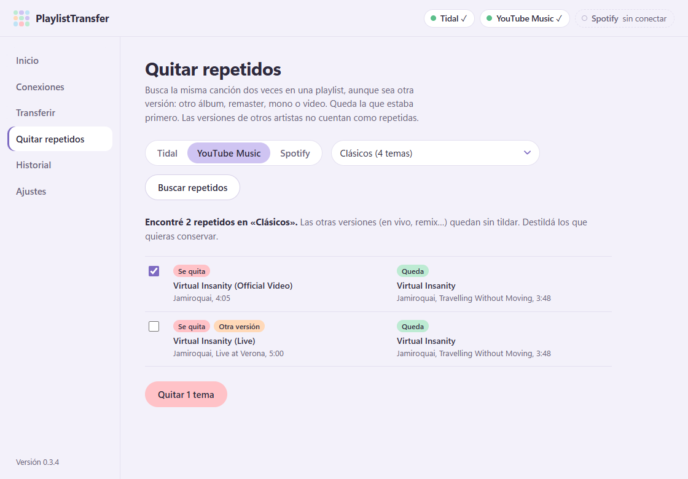
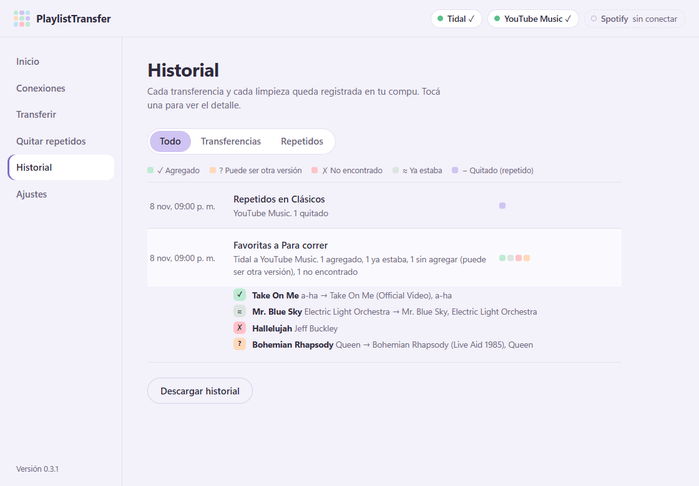

# PlaylistTransfer

[English](README.md) · **Castellano**

[](https://github.com/On33-3/PlaylistTransfer/actions/workflows/build.yml)

Una app de escritorio para Windows que **pasa tus playlists entre Tidal, YouTube Music y Spotify** y **quita temas repetidos**. Gratis, open source y sin cuentas propias: todo pasa en tu compu.

También es un proyecto de portfolio de QA: mirá [cómo se prueba](#cómo-se-prueba).



## Descargar

1. Entrá a [**Releases**](../../releases/latest) y bajá `PlaylistTransfer-<versión>-windows.zip`.
2. Descomprimilo donde quieras (por ejemplo, en Documentos).
3. Abrí `PlaylistTransfer.exe`. No hace falta instalar Python.

> **Windows puede avisarte o bloquear la app la primera vez**, porque todavía no está firmada digitalmente. En [Avisos de Windows](#avisos-de-windows) está qué significa cada uno y qué podés hacer.

Funciona en Windows 10 y 11.

## Avisos de Windows

PlaylistTransfer todavía no está firmada digitalmente, así que Windows puede frenarla la primera vez que la abrís:

- **«Windows protegió su PC»** (SmartScreen): tocá **Más información → Ejecutar de todas formas**.
- **«El Control inteligente de aplicaciones bloqueó una aplicación»** (*Smart App Control*): en Windows 11 solo deja abrir un programa si Microsoft ya lo conoce o si está firmado, y no hay forma de autorizar un programa solo. Si lo tenés encendido, PlaylistTransfer no abre. Podés esperar una versión firmada, o apagarlo vos en **Seguridad de Windows › Control de aplicaciones y navegador › Control inteligente de aplicaciones** (un Windows 11 actualizado deja volver a encenderlo después). Es tu decisión: no te pedimos que bajes la protección de tu compu por esta app.

**Por qué no está firmada.** Un certificado de firma se paga todos los años, y este es un proyecto gratis. Las opciones gratuitas todavía no están disponibles para él: la [SignPath Foundation](https://signpath.org/), que firma gratis proyectos de código abierto, pide antes más visibilidad pública, y el servicio de firma de Microsoft solo acepta personas de Estados Unidos y Canadá. La firma se va a volver a pedir a medida que el proyecto crezca (las estrellas y las menciones ayudan).

**Lo que podés comprobar mientras tanto:**

- Cada versión trae el código SHA-256 del zip. En PowerShell, `Get-FileHash PlaylistTransfer-<versión>-windows.zip` tiene que mostrar el mismo código.
- Cada zip lo arma GitHub Actions a partir del código de este repositorio, y el registro de cada armado es público en [Actions](../../actions).
- Podés analizar el zip vos en [VirusTotal](https://www.virustotal.com/).

## Qué hace

**Transferir.** Elegís una playlist de origen y una o varias de destino (o una nueva). Ves cada tema en vivo: ✓ agregado, ? puede ser otra versión (decidís vos al final), ✗ no encontrado y ≈ ya estaba. Con *Probar sin cambiar nada* ves el resultado antes de tocar tus playlists.



**Quitar repetidos.** En una playlist o en todas a la vez, encuentra la misma canción dos veces aunque sea otro video, un remaster u otra portada. Las versiones en vivo o remix aparecen sin tildar, y nada se quita sin que lo confirmes.



**Historial.** Cada transferencia y cada limpieza quedan registradas con el detalle de cada tema. Si querés, lo descargás como un archivo de texto liviano, fácil de leer o de pasarle a una IA.



## Cómo se prueba

Las pruebas parten de los riesgos: quitar una canción que querías, agregar la equivocada, filtrar datos personales, dejar una playlist a medias o que el `.exe` no abra en otra PC.

- **Más de 500 tests automatizados en cada cambio**, en GitHub Actions: las reglas del matching, el motor, los conectores (Spotify contra una Web API falsa) y cada pantalla de punta a punta con Playwright.
- **Una prueba con cuentas reales antes de cada versión** (`tools/real_check.py`): en cada servicio quita repetidos de verdad en una playlist descartable, y un guardia bloquea cualquier cambio fuera de ella.
- **Normas de diseño medidas, no a ojo:** tamaños, íconos centrados y ningún texto cortado en cada pantalla, también en la ventana más chica.
- **Cada error encontrado suma un test que ahora lo impide.** [TESTING.md](TESTING.md) (en inglés) los lista, con quién o qué encontró cada uno.

## Spotify

Spotify es opcional y pide dos cosas (las exige Spotify desde 2026, no la app):

1. **Spotify Premium.**
2. **Tu propia app de Spotify**, gratis: en **Conexiones › Spotify › Configurar** la app te guía paso por paso, con un botón para cada página y para copiar cada dato que hay que pegar. La usan solo vos y hasta 5 personas que agregues.

> **Probado con una cuenta Premium real:** transferir, quitar repetidos y «Canciones que te gustan», comprobados de nuevo con una cuenta real antes de cada versión. Spotify cambia su panel de desarrolladores cada tanto: si algún nombre de botón de los pasos no coincide con lo que ves, avisanos.

Detalles: Spotify solo deja leer tus playlists y las colaborativas; cada 6 meses pide volver a conectar. Para quitar un repetido exacto, Spotify saca todas las copias, así que la app vuelve a poner la que queda en su lugar (aparece como agregada de nuevo) y lo verifica. Entre Tidal y Spotify las coincidencias suelen ser exactas (las dos usan el código ISRC de cada grabación).

## Cómo decide si es "la misma canción"

- Tiene que coincidir **el artista**. Una canción puede tenerla más de un artista: si buscás el *Hallelujah* de Jeff Buckley y solo está el de Leonard Cohen, no se agrega solo; la app te lo ofrece y decidís vos.
- Covers, karaokes y tributos no cuentan como el original.
- Partes y secuelas son temas distintos (*Pt. 1* ≠ *Pt. 2*, *The Unforgiven* ≠ *The Unforgiven II*), y un *Intro* de otro álbum también.
- Una versión en vivo, acústica o remix del mismo tema queda marcada con **?** y **no se agrega sola**: al final decidís con "+ Agregar igual".

Los umbrales se pueden ajustar en **Ajustes › Coincidencias**.

La app está en **castellano e inglés** (Ajustes › Idioma). La primera vez usa el idioma de Windows.

## Privacidad

- Iniciás sesión en tu propio navegador. Tus sesiones, preferencias e historial se guardan **solo en tu compu**, en `%LOCALAPPDATA%\PlaylistTransfer`. Para borrar todo, usá **Ajustes › Borrar todo**: la app queda como la primera vez, y tus playlists no se tocan.
- La app no tiene servidores ni estadísticas: solo habla con Tidal, YouTube Music y Spotify.
- El programa no envía información a otros sistemas salvo que lo pida quien lo usa: solo se conecta con los servicios de música en los que iniciás sesión.

No está afiliado a Tidal, Google ni Spotify.

## Limitaciones conocidas

Saber qué no anda todavía importa tanto como saber qué anda:

- **Todavía no está firmada**: Windows puede avisar o bloquearla (ver [Avisos de Windows](#avisos-de-windows)).
- **Tidal y YouTube Music funcionan con librerías no oficiales** ([tidalapi](https://github.com/tamland/python-tidal) y [ytmusicapi](https://github.com/sigma67/ytmusicapi)). Si un servicio cambia algo, la app puede dejar de andar hasta que se actualicen. Antes de cada versión se prueba con cuentas reales en los tres servicios ([TESTING.md](TESTING.md), en inglés). Spotify usa su API oficial, con la app que creás vos.
- **Los mixes automáticos de YouTube** guardados en tu biblioteca no se pueden leer como una playlist: Quitar repetidos los muestra como no leídos y revisa el resto.
- **Spotify** pide Premium y tu propia app de desarrollador (hasta 5 personas por app). Su límite de pedidos puede pausar una transferencia grande, a veces por horas: la app te dice hasta qué hora y sigue desde donde quedó.
- **Solo Windows** (10 y 11).

¿Encontraste algo más? [Abrí un issue](../../issues).

## Para desarrollar

Necesitás Windows y Python 3.14.

```powershell
py -m pip install -r requirements-dev.txt
py -m pytest -q                 # tests (los de la UI necesitan playwright y Edge)
py -m app                       # abre la app
py packaging/build.py           # arma dist/PlaylistTransfer-<versión>-windows.zip
py tools/real_check.py          # antes de publicar: la UI real con tus cuentas (solo escribe en una playlist de prueba que borra)
```

- `app/core/`: el motor (coincidencias, repetidos, transferencias). Cada regla tiene su escenario en `tests/test_scenarios.py`.
- `app/connectors/`: un conector por servicio, con la misma interfaz. Todos se declaran en `registry.py`: de ahí salen la API y la ventana.
- `app/ui/`: la interfaz (HTML, CSS y JS, sin frameworks), dentro de una ventana de [pywebview](https://pywebview.flowrl.com/).
- [`TESTING.md`](TESTING.md): cómo se prueba, de los riesgos a los errores que encontró la automatización (en inglés).
- [`CHANGELOG.md`](CHANGELOG.md): qué cambió en cada versión (en inglés).
- [`SPEC.md`](SPEC.md): el plan, las fases y por qué se decidió cada cosa.
- Los comentarios y docstrings del código están en inglés; `docs/`, `SPEC.md` y `CLAUDE.md`, en castellano.
- Publicar una versión: subí el número en `app/__init__.py` y creá el tag `vX.Y.Z`. GitHub Actions corre los tests, compila el `.exe`, prueba que abra y lo publica en Releases.

## Licencia

Copyright © 2026 Emmanuel Gaitan. PlaylistTransfer es software libre con licencia [GNU GPL v3 o posterior](LICENSE): se puede usar, estudiar, compartir y modificar, y quien lo distribuya, con cambios o sin ellos, tiene que hacerlo con la misma licencia, su código fuente y este aviso de copyright.

Las librerías incluidas tienen sus propias licencias (ver `THIRD-PARTY-NOTICES.txt` dentro del zip). tidalapi es LGPL-3.0: en la app va como archivos `.py` sueltos en `_internal\tidalapi`, así se puede reemplazar por otra versión.
