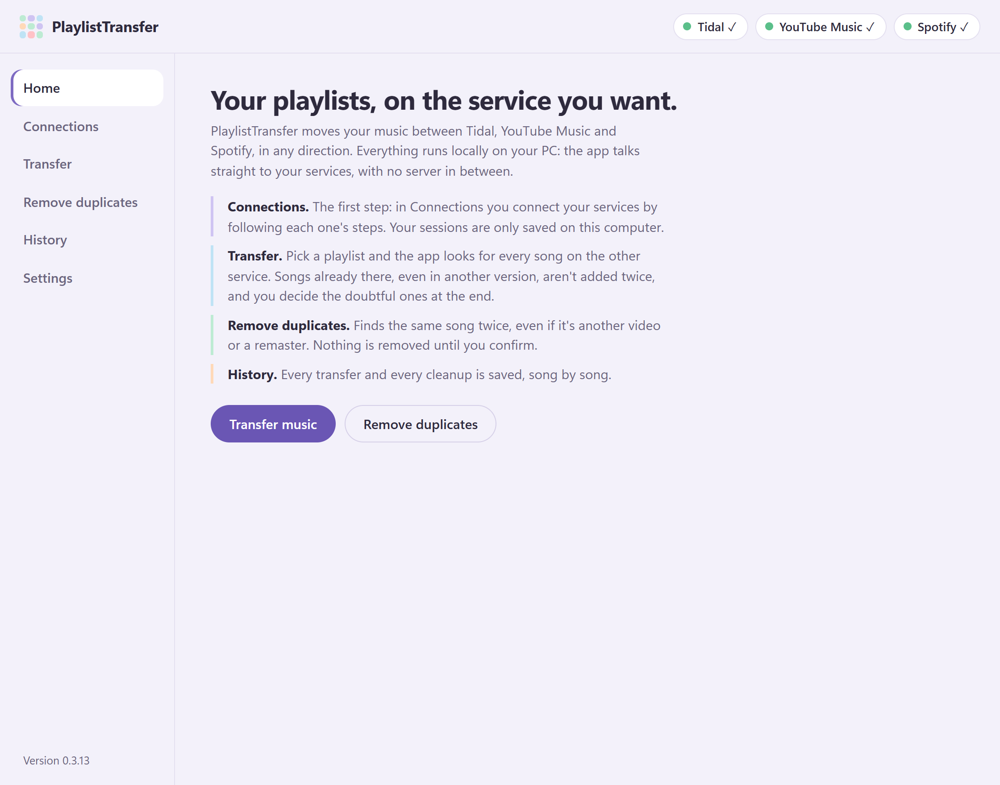
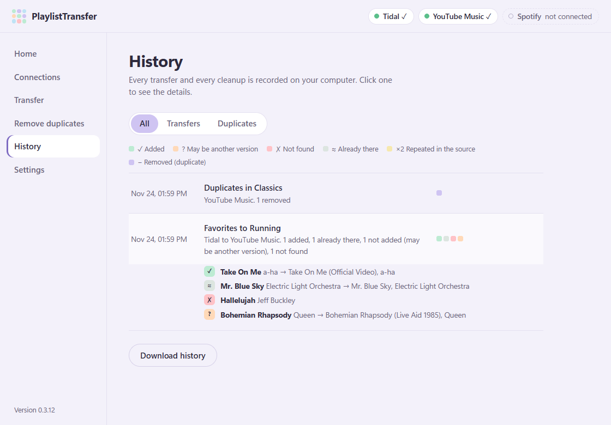

# PlaylistTransfer

**English** · [Castellano](README.es.md)

A Windows desktop app that **moves your playlists between Tidal, YouTube Music and Spotify** and **removes duplicate songs**. Free, open source and with no accounts of its own: everything happens on your computer.



## Download

1. Go to [**Releases**](../../releases/latest) and download `PlaylistTransfer-<version>-windows.zip`.
2. Unzip it anywhere (for example, in Documents).
3. Open `PlaylistTransfer.exe`. You don't need to install Python.

> **Windows protected your PC:** this shows up because the program isn't digitally signed yet. Click **More info → Run anyway**. If you want to verify the file, every release includes its SHA-256 checksum.

Works on Windows 10 and 11.

## What it does

**Transfer.** Pick a source playlist and one or more destinations (or a new one). You see every song live: ✓ added, ? may be another version (you decide at the end), ✗ not found and ≈ already there. With *Preview without changes* you see the result before touching your playlists.


**Remove duplicates.** In one playlist or all of them at once, finds the same song twice even if it's another video, a remaster or another cover. Live versions and remixes are left unchecked, and nothing is removed until you confirm.


**History.** Every transfer and every cleanup is recorded, song by song. If you want, you can download it as a lightweight text file, easy to read or to hand to an AI.



## Spotify

Spotify is optional and requires two things (Spotify has required them since 2026, not the app):

1. **Spotify Premium.**
2. **Your own Spotify app**, free: in **Connections › Spotify › Set up** the app guides you step by step, with a button for each page and for copying each value you need to paste. Only you and up to 5 people you add can use it.

> **Still being tested:** the Spotify connection is tested against a simulation of its API, but nobody has tried it with a real Premium account yet. If you do, let us know how it went (and whether any button name in the steps doesn't match what you see on Spotify).

Details: Spotify only lets apps read your own and collaborative playlists, and asks you to reconnect every 6 months. To remove an exact duplicate, Spotify removes every copy, so the app puts the remaining one back in its place (it shows up as added again) and checks it. Between Tidal and Spotify matches are usually exact (both use each recording's ISRC code).

## How it decides it's "the same song"

- **The artist** has to match. A song can be recorded by more than one artist: if you're looking for Jeff Buckley's *Hallelujah* and only Leonard Cohen's is there, it isn't added on its own; the app offers it and you decide.
- Covers, karaoke and tribute versions don't count as the original.
- Parts and sequels are different songs (*Pt. 1* ≠ *Pt. 2*, *The Unforgiven* ≠ *The Unforgiven II*), and so is an *Intro* from another album.
- A live, acoustic or remix version of the same song is marked with **?** and **isn't added on its own**: at the end you decide with "+ Add anyway".

The thresholds can be adjusted in **Settings › Matching**.

The app is available in **English and Spanish** (Settings › Language). The first time, it uses your Windows language.

## Privacy

- You sign in with your own browser. Your sessions, preferences and history are stored **only on your computer**, in `%LOCALAPPDATA%\PlaylistTransfer`. To delete everything, use **Settings › Erase everything**: the app goes back to how it was the first time, and your playlists are not touched.
- The app has no servers and no analytics: it only talks to Tidal, YouTube Music and Spotify.
- It uses **unofficial** libraries ([tidalapi](https://github.com/tamland/python-tidal) and [ytmusicapi](https://github.com/sigma67/ytmusicapi)). If a service changes something, it may stop working until they're updated. Spotify uses its official API, with the app you create.

Not affiliated with Tidal, Google or Spotify.

## Development

You need Windows and Python 3.14.

```powershell
py -m pip install -r requirements-dev.txt
py -m pytest -q                 # tests (the UI ones need playwright and Edge)
py -m app                       # opens the app
py packaging/build.py           # builds dist/PlaylistTransfer-<version>-windows.zip
py tools/real_check.py          # before a release: the real UI with your accounts (it only writes to a test playlist it deletes)
```

- `app/core/`: the engine (matching, duplicates, transfers). Each rule has its scenario in `tests/test_scenarios.py`.
- `app/connectors/`: one connector per service, all with the same interface. They're all declared in `registry.py`: the API and the window are built from there.
- `app/ui/`: the interface (HTML, CSS and JS, no frameworks), inside a [pywebview](https://pywebview.flowrl.com/) window.
- [`SPEC.md`](SPEC.md): the plan, the phases and why each decision was made (in Spanish).
- Code comments are still in Spanish; translating them is planned.
- Releasing a version: bump the number in `app/__init__.py` and `pyproject.toml` and push the tag `vX.Y.Z`. GitHub Actions runs the tests, builds the `.exe`, checks that it opens and publishes it in Releases.

## License

Copyright © 2026 Emmanuel Gaitan. Free software under the [GNU GPL v3 or later](LICENSE).

The bundled libraries have their own licenses (see `THIRD-PARTY-NOTICES.txt` inside the zip). tidalapi is LGPL-3.0: the app ships it as plain `.py` files in `_internal\tidalapi`, so it can be replaced with another version.
