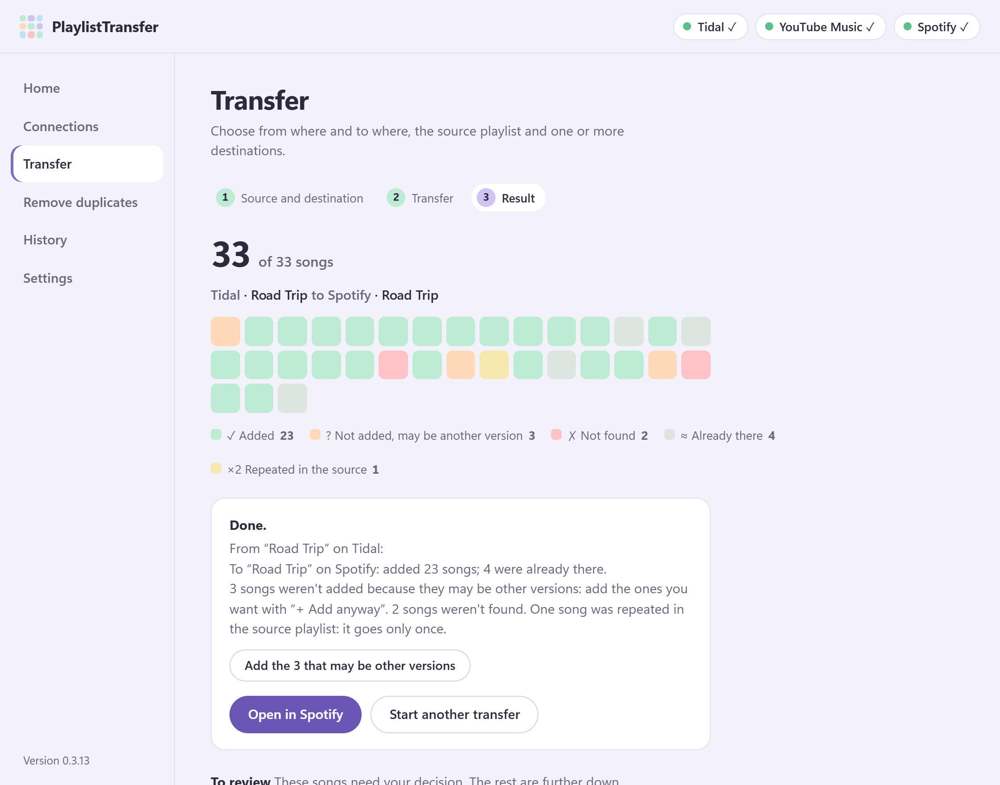
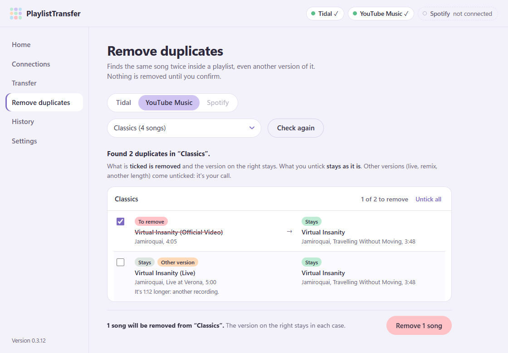

# PlaylistTransfer

**English** · [Castellano](README.es.md)

[](https://github.com/On33-3/PlaylistTransfer/actions/workflows/build.yml)

A Windows desktop app that **moves your playlists between Tidal, YouTube Music and Spotify** and **removes duplicate songs**. Free, open source and with no accounts of its own: everything happens on your computer.

Also a QA portfolio project: see [how it's tested](#how-its-tested).


## Download

1. Go to [**Releases**](../../releases/latest) and download `PlaylistTransfer-<version>-windows.zip`.
2. Unzip it anywhere (for example, in Documents).
3. Open `PlaylistTransfer.exe`. You don't need to install Python.

> **Windows may warn you or block the app the first time**, because it isn't digitally signed yet. [Windows warnings](#windows-warnings) explains each one and what you can do.

Works on Windows 10 and 11.

## Windows warnings

PlaylistTransfer isn't digitally signed yet, so Windows may stop it the first time you open it:

- **"Windows protected your PC"** (SmartScreen): click **More info → Run anyway**.
- **"Smart App Control blocked an app"**: Windows 11's Smart App Control only lets a program run if Microsoft already knows it or if it's signed, and there's no way to allow a single program. If it's on, PlaylistTransfer won't open. You can wait for a signed version, or turn it off yourself in **Windows Security › App & browser control › Smart App Control** (an up-to-date Windows 11 lets you turn it back on later). It's your call: we don't ask you to lower your computer's protection for this app.

**Why it isn't signed.** A code signing certificate is paid every year, and this is a free project. The free options aren't open to it yet: the [SignPath Foundation](https://signpath.org/), which signs open source projects for free, asks for more public visibility first, and Microsoft's own signing service only accepts individuals in the United States and Canada. Signing will be requested again as the project grows (stars and mentions help).

**What you can check meanwhile:**

- Every release lists the zip's SHA-256. In PowerShell, `Get-FileHash PlaylistTransfer-<version>-windows.zip` has to show the same code.
- Every zip is built by GitHub Actions from this repository's code, and the log of every build is public in [Actions](../../actions).
- You can scan the zip yourself on [VirusTotal](https://www.virustotal.com/).

## What it does

**Transfer.** Pick a source playlist and one or more destinations (or a new one). You see every song live: ✓ added, ? may be another version (you decide at the end), ✗ not found and ≈ already there. With *Preview without changes* you see the result before touching your playlists.



**Remove duplicates.** In one playlist or all of them at once, finds the same song twice even if it's another video, a remaster or another cover. Live versions and remixes are left unchecked, and nothing is removed until you confirm.



**History.** Every transfer and every cleanup is recorded, song by song. If you want, you can download it as a lightweight text file, easy to read or to hand to an AI.


## How it's tested

The testing starts from the risks: removing a song you wanted, adding the wrong one, leaking personal data, leaving a playlist half-changed, or an `.exe` that doesn't open on someone else's PC.

- **500+ automated tests on every push**, in GitHub Actions: the matching rules, the engine, the connectors (Spotify against a fake Web API) and every screen end to end with Playwright.
- **A check with real accounts before each release** (`tools/real_check.py`): on each service it removes duplicates for real in a throwaway playlist, and a guard blocks any write outside it.
- **Design rules measured, not eyeballed:** sizes, centered icons and no cut-off text on every screen, also at the smallest window size.
- **Every bug found gets a test that now guards it.** [TESTING.md](TESTING.md) lists them, with who or what found each one.

## Spotify

Spotify is optional and requires two things (Spotify has required them since 2026, not the app):

1. **Spotify Premium.**
2. **Your own Spotify app**, free: in **Connections › Spotify › Set up** the app guides you step by step, with a button for each page and for copying each value you need to paste. Only you and up to 5 people you add can use it.

> **Tested with a real Premium account:** transferring, removing duplicates and Liked songs, checked again with a real account before each release. Spotify changes its developer dashboard from time to time: if a button name in the setup steps doesn't match what you see, let us know.

Details: Spotify only lets apps read your own and collaborative playlists, and asks you to reconnect every 6 months. To remove an exact duplicate, Spotify removes every copy, so the app puts the remaining one back in its place (it shows up as added again) and checks it. Between Tidal and Spotify matches are usually exact (both use each recording's ISRC code).

## How it decides it's "the same song"

- **The artist** has to match. A song can be recorded by more than one artist: if you're looking for Jeff Buckley's *Hallelujah* and only Leonard Cohen's is there, it isn't added on its own; the app offers it and you decide.
- Covers, karaoke and tribute versions don't count as the original.
- Parts and sequels are different songs (*Pt. 1* ≠ *Pt. 2*, *The Unforgiven* ≠ *The Unforgiven II*), and so is an *Intro* from another album.
- A live, acoustic or remix version of the same song is marked with **?** and **isn't added on its own**: at the end you decide with "+ Add anyway".

The thresholds can be adjusted in **Settings › Matching**.

The app is available in **English and Spanish** (Settings › Language). The first time, it uses your Windows language.

## Privacy

- You sign in with your own browser. Your sessions, preferences and history are stored **only on your computer**, in `%LOCALAPPDATA%\PlaylistTransfer`. To delete everything, use **Settings › Erase everything**: the app goes back to how it was the first time, and your playlists are not touched.
- The app has no servers and no analytics: it only talks to Tidal, YouTube Music and Spotify.
- This program will not transfer any information to other networked systems unless specifically requested by the user or the person installing or operating it: it only connects to the music services you sign in to.

Not affiliated with Tidal, Google or Spotify.

## Known limitations

Knowing what doesn't work yet matters as much as knowing what does:

- **It isn't signed yet**: Windows may warn or block it (see [Windows warnings](#windows-warnings)).
- **Tidal and YouTube Music work through unofficial libraries** ([tidalapi](https://github.com/tamland/python-tidal) and [ytmusicapi](https://github.com/sigma67/ytmusicapi)). If a service changes something, the app may stop working until they're updated. Before each release it's checked with real accounts on the three services ([TESTING.md](TESTING.md)). Spotify uses its official API, with the app you create.
- **YouTube's automatic mixes** saved to your library can't be read like a playlist: Remove duplicates lists them as not read and checks the rest.
- **Spotify** needs Premium and your own developer app (up to 5 people per app). Its request limit can pause a large transfer, sometimes for hours: the app tells you until when, and picks up where it stopped.
- **Windows only** (10 and 11).

Found something else? [Open an issue](../../issues).

## Development

You need Windows and Python 3.14.

```powershell
py -m pip install -r requirements-dev.txt
py -m pytest -q                 # tests (the UI ones need playwright and Edge)
py -m app                       # opens the app
py packaging/build.py           # builds dist/PlaylistTransfer-<version>-windows.zip
py tools/real_check.py          # before a release: the real UI with your accounts (it only writes to a test playlist it deletes)
```

- `app/core/`: the engine (matching, duplicates, transfers). Each rule has its scenario in `tests/test_scenarios.py`.
- `app/connectors/`: one connector per service, all with the same interface. They're all declared in `registry.py`: the API and the window are built from there.
- `app/ui/`: the interface (HTML, CSS and JS, no frameworks), inside a [pywebview](https://pywebview.flowrl.com/) window.
- [`TESTING.md`](TESTING.md): how it's tested, from the risks to the bugs the automation caught.
- [`CHANGELOG.md`](CHANGELOG.md): what changed in each version.
- [`SPEC.md`](SPEC.md): the plan, the phases and why each decision was made (in Spanish).
- Code comments and docstrings are in English; the docs in `docs/`, `SPEC.md` and `CLAUDE.md` are in Spanish.
- Releasing a version: bump the number in `app/__init__.py` and `pyproject.toml` and push the tag `vX.Y.Z`. GitHub Actions runs the tests, builds the `.exe`, checks that it opens and publishes it in Releases.

## License

Copyright © 2026 Emmanuel Gaitan. PlaylistTransfer is free software under the [GNU GPL v3 or later](LICENSE): you can use, study, share and change it, and if you distribute it, changed or not, it has to stay under the same license, with its source code and this copyright notice.

The bundled libraries have their own licenses (see `THIRD-PARTY-NOTICES.txt` inside the zip). tidalapi is LGPL-3.0: the app ships it as plain `.py` files in `_internal\tidalapi`, so it can be replaced with another version.
