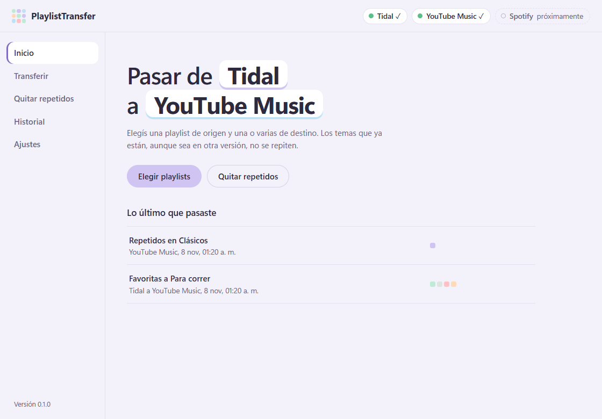
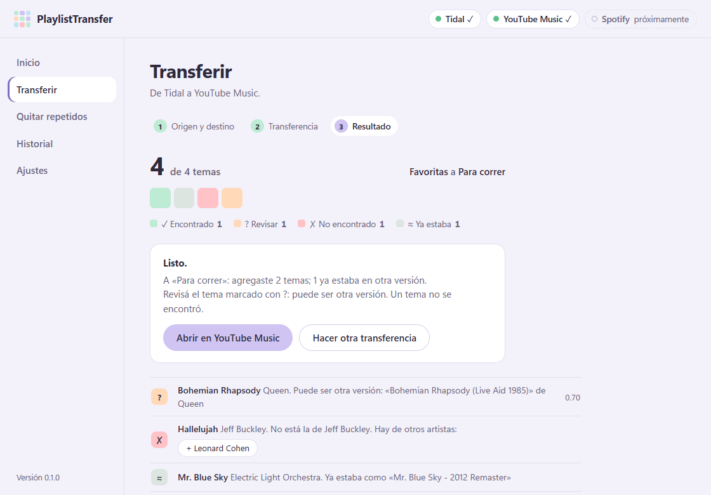
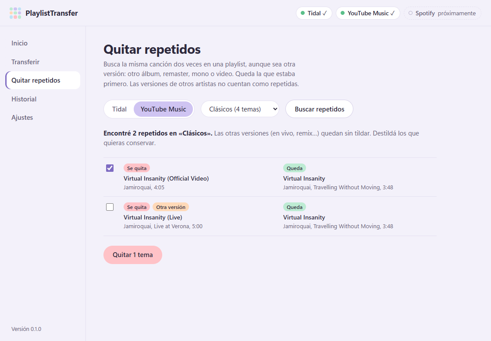
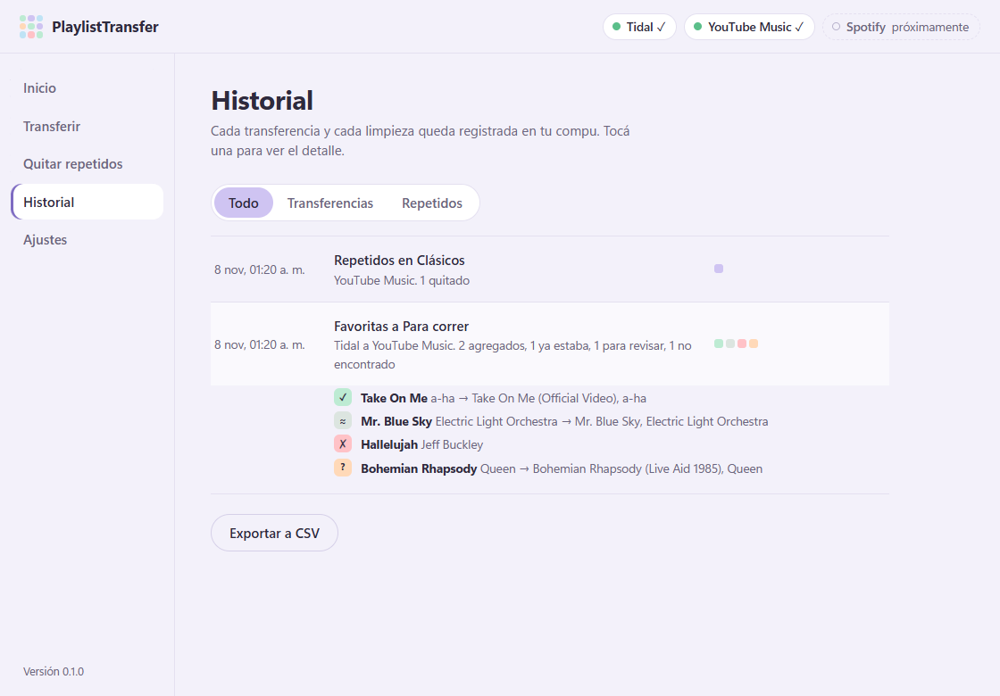

# PlaylistTransfer

Una app de escritorio para Windows que **pasa tus playlists entre Tidal y YouTube Music** y **quita temas repetidos**. Gratis, open source y sin cuentas propias: todo pasa en tu compu.



## Descargar

1. Entrá a [**Releases**](../../releases/latest) y bajá `PlaylistTransfer-<versión>-windows.zip`.
2. Descomprimilo donde quieras (por ejemplo, en Documentos).
3. Abrí `PlaylistTransfer.exe`. No hace falta instalar Python.

> **Windows protegió su PC:** aparece porque el programa todavía no está firmado digitalmente. Tocá **Más información → Ejecutar de todas formas**. Si querés verificar el archivo, cada release trae su código SHA-256.

Funciona en Windows 10 y 11.

## Qué hace

**Transferir.** Elegís una playlist de origen y una o varias de destino (o una nueva). Ves cada tema en vivo: ✓ encontrado, ? para revisar, ✗ no encontrado y ≈ ya estaba. Con *Probar sin cambiar nada* ves el resultado antes de tocar tus playlists.



**Quitar repetidos.** Encuentra la misma canción dos veces aunque sea otro video, un remaster u otra portada. Las versiones en vivo o remix aparecen sin tildar, y nada se quita sin que lo confirmes.



**Historial.** Cada transferencia y cada limpieza quedan registradas con el detalle de cada tema. Si querés, lo exportás a CSV para abrirlo en Excel.



## Cómo decide si es "la misma canción"

- Tiene que coincidir **el artista**. Una canción puede tenerla más de un artista: si buscás el *Hallelujah* de Jeff Buckley y solo está el de Leonard Cohen, no se agrega solo; la app te lo ofrece y decidís vos.
- Covers, karaokes y tributos no cuentan como el original.
- Partes y secuelas son temas distintos (*Pt. 1* ≠ *Pt. 2*, *The Unforgiven* ≠ *The Unforgiven II*), y un *Intro* de otro álbum también.
- Una versión en vivo, acústica o remix del mismo tema queda marcada con **?** para que la revises.

Los umbrales se pueden ajustar en **Ajustes › Coincidencias**.

## Privacidad

- Iniciás sesión en tu propio navegador. Tus sesiones, preferencias e historial se guardan **solo en tu compu**, en `%LOCALAPPDATA%\PlaylistTransfer`. Para borrar todo, cerrá la app y borrá esa carpeta.
- La app no tiene servidores ni estadísticas: solo habla con Tidal y YouTube Music.
- Usa librerías **no oficiales** ([tidalapi](https://github.com/tamland/python-tidal) y [ytmusicapi](https://github.com/sigma67/ytmusicapi)). Si un servicio cambia algo, puede dejar de andar hasta que se actualicen.

No está afiliado a Tidal, Google ni Spotify.

## Para desarrollar

Necesitás Windows y Python 3.14.

```powershell
py -m pip install -r requirements-dev.txt
py -m pytest -q                 # tests (los de la UI necesitan playwright y Edge)
py -m app                       # abre la app
py packaging/build.py           # arma dist/PlaylistTransfer-<versión>-windows.zip
```

- `app/core/`: el motor (coincidencias, repetidos, transferencias). Cada regla tiene su escenario en `tests/test_scenarios.py`.
- `app/connectors/`: un conector por servicio, con la misma interfaz. Spotify viene después.
- `app/ui/`: la interfaz (HTML, CSS y JS, sin frameworks), dentro de una ventana de [pywebview](https://pywebview.flowrl.com/).
- [`SPEC.md`](SPEC.md): el plan, las fases y por qué se decidió cada cosa.
- Publicar una versión: subí el número en `app/__init__.py` y creá el tag `vX.Y.Z`. GitHub Actions corre los tests, compila el `.exe`, prueba que abra y lo publica en Releases.

La versión de consola original sigue en [`legacy/`](legacy/).

## Licencia

Copyright © 2026 Emmanuel Gaitan. Software libre con licencia [GNU GPL v3 o posterior](LICENSE).

Las librerías incluidas tienen sus propias licencias (ver `THIRD-PARTY-NOTICES.txt` dentro del zip). tidalapi es LGPL-3.0: en la app va como archivos `.py` sueltos en `_internal\tidalapi`, así se puede reemplazar por otra versión.
